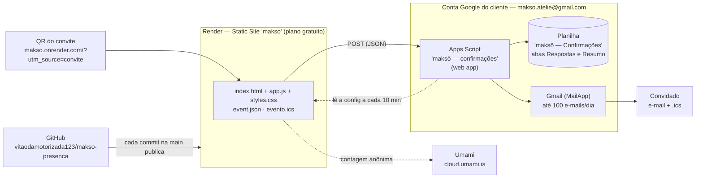

# maksō — documentação do sistema

Documentação técnica da página de confirmação de presença do lançamento da **maksō**. Explica como as peças se ligam, o que garante que o site fique no ar e como operar o sistema até o evento e depois dele.

- **Para quem:** quem mantém o sistema (DIMAK Soluções).
- **Situação:** revisado em 18/11/2026, à noite (depois dos ajustes de visual, campos e prazo).
- **Para o cliente:** existe um documento separado, em linguagem simples.

---

## 1. Resumo em 30 segundos

O convidado escaneia o QR do convite e abre `https://makso.onrender.com`. Ali ele preenche nome completo, e-mail (duas vezes), telefone e, se quiser, uma restrição alimentar. O site manda a resposta para um script do Google, na conta do cliente. Esse script:

1. confere se a resposta é válida e se não é repetida;
2. grava uma linha na planilha **"maksō — Confirmações"**;
3. manda ao convidado um e-mail de confirmação com o convite de agenda (`.ics`).

| Garantia pedida | Situação | Por quê |
|---|---|---|
| O site nunca "dorme" | ✅ Garantido | É um **Static Site** no Render. O desligamento por inatividade só existe para *Web Services* gratuitos |
| O QR nunca expira | ✅ Garantido | O QR é **estático**: guarda só o endereço `https://makso.onrender.com/?utm_source=convite` e não passa por nenhum serviço de QR |
| Os dados nunca se perdem | ✅ Garantido, com 2 cuidados | As respostas ficam numa **planilha Google**, que não expira. Cuidados: manter a planilha compartilhada com a DIMAK e nunca criar uma "Nova implantação" do script (seção 7) |

---

## 2. Arquitetura



### Componentes

| Componente | Onde roda | Conta | Custo | Pode dormir ou expirar? |
|---|---|---|---|---|
| Site | Render, **Static Site** `makso` | Conta Render do site | Grátis | **Não dorme.** Limite de banda: 5 GB/mês (seção 6) |
| Código | GitHub `vitaodamotorizada123/makso-presenca` | GitHub do Victor | Grátis | Não |
| Script de confirmação | Google Apps Script, web app | `makso.atelie@gmail.com` | Grátis | Não. Só a **URL** muda se alguém criar uma "Nova implantação" |
| Planilha | Google Drive | `makso.atelie@gmail.com` | Grátis | Não |
| E-mails | Gmail via `MailApp` | `makso.atelie@gmail.com` | Grátis | Cota de 100 por dia; o excedente vai para uma fila |
| Contagem de visitas | Umami Cloud, plano Hobby | Login com o GitHub do Victor | Grátis | O histórico fica guardado por 6 meses |
| QR code | Arquivos `assets/qr/qr-makso.svg` e `.png` | — | — | Não |

---

## 3. Como uma confirmação funciona

### 3.1 No navegador (`src/js/`)

1. **Tela 1:** logo no topo (flutuando de leve), a frase do convite em cursiva (sempre 4 linhas), o botão "Confirme sua presença" e, embaixo, `10 . 12 . 2026` e `19h30`.
2. O clique abre a **tela 2** em `#confirmar`. O formulário só aparece depois desse clique. O "voltar" do celular (ou o "‹ Voltar" da página) retorna à tela 1 sem apagar o que foi digitado.
3. O convidado preenche:
   - nome completo;
   - e-mail;
   - confirmação do e-mail (precisa ser igual; é conferida só no navegador e não é enviada);
   - telefone (rótulo "Telefone"; o campo interno e a coluna da planilha continuam `whatsapp` / `WhatsApp`);
   - restrição alimentar (opcional).

   Não há mais o campo "Observação".

   Não há escolha de "vou / não vou": quem abre o formulário está confirmando. Também não há acompanhante, porque os convites são individuais.
4. O formulário é validado com as **mesmas regras** do servidor (`shared/rules.js`).
5. O site monta o envio:
   - um `id` (UUID), que dá para repetir com segurança se a rede falhar;
   - dois campos antispam: `hp`, um campo invisível que só robôs preenchem, e `t`, o tempo em milissegundos desde que o formulário abriu.
6. Envia um `POST` para o Apps Script:
   - em `text/plain`, o que evita a checagem extra de CORS do navegador;
   - com prazo de 15 s.
7. Mostra o resultado:
   - **"obrigado" (tela 3):** logo no topo, "Sua presença foi confirmada.", "Enviamos os detalhes para…", a frase "Prepare-se para desvendar as bolsas mais icônicas que você já viu!" em cursiva (sempre 3 linhas), o bloco data / endereço / horário, o link "Ver no mapa", os botões de agenda (Google Agenda e Apple/Outlook) e as **informações importantes** (horário de início, chuva, estacionamento, acesso ao condomínio, dúvidas pelo (31) 98727-2711);
   - ou "Sua resposta já está registrada.";
   - ou erro com "Tentar de novo", que reenvia o mesmo `id`.

### 3.2 No Apps Script (`apps-script/src/Submission.js`)

| Passo | O que faz | Resposta se barrar |
|---|---|---|
| 1. Corpo | Texto JSON de até 10 KB | `invalido` |
| 2. Antispam | Se `hp` vier preenchido ou `t` < 800 ms, **não grava** (o descarte fica no log) | Finge sucesso (`ok: true`), para o robô não perceber |
| 3. Validação | Nome de 2 a 80 caracteres, e-mail válido, WhatsApp com DDD, textos dentro do limite | `invalido` + campos |
| 4. Prazo | Fora do prazo ou depois do evento | `encerrado` |
| 5. Limite | No máximo 60 confirmações a cada 10 minutos, somando todos os convidados | `erro` |
| 6. Trava (`LockService`) | Uma gravação por vez, para não duplicar | `erro` (o site oferece "Tentar de novo") |
| 7. Repetição | Mesmo `id`: devolve o resultado original. Mesmo e-mail ou WhatsApp: recusa | `ja_respondeu` |
| 8. Gravação | Uma linha nova na aba `Respostas` | — |
| 9. E-mail | Enviado **fora** da trava. Se falhar, a confirmação continua valendo | — |

### 3.3 Contrato da API

**Pedido** (`POST`, corpo JSON como texto):

```json
{
  "id": "uuid-v4",
  "presenca": "sim",
  "nome": "Maria Silva",
  "email": "maria@exemplo.com",
  "whatsapp": "(31) 99999-9999",
  "acompanhante": false,
  "acompanhanteNome": "",
  "restricao": "",
  "observacao": "",
  "hp": "",
  "t": 12345
}
```

O campo `emailConfirmacao` do formulário **não** vai no pedido. `presenca` é sempre `"sim"`, `acompanhante` sempre `false` e `observacao` sempre vazio.

**Respostas possíveis:**

| Resposta | Quando |
|---|---|
| `{"ok": true, "status": "confirmado"}` | Gravou (ou já tinha gravado este mesmo `id`) |
| `{"ok": false, "code": "ja_respondeu"}` | Este e-mail ou WhatsApp já confirmou |
| `{"ok": false, "code": "invalido", "campos": {…}}` | Algum campo não passou na validação |
| `{"ok": false, "code": "encerrado"}` | Fora do prazo |
| `{"ok": false, "code": "erro"}` | Falha temporária. O site mostra "Tentar de novo" |

**Verificação de saúde:** abrir a URL do script no navegador (`GET`) deve mostrar `{"ok":true,"service":"makso-rsvp",…}`.

---

## 4. Datas e estados da página

As datas vêm do `config.json`. O build confere tudo e falha se algo estiver errado.

| Estado | Quando | O que o convidado vê |
|---|---|---|
| `aberto` | Até o prazo | Formulário |
| `encerrado` | Do prazo até o fim do evento | "Confirmações encerradas" |
| `passado` | Depois do fim do evento | Aviso de que o evento já aconteceu |
| `em_breve` | Se `appsScriptUrl` estiver vazio | "Confirmações abrem em breve." |

**Com a configuração atual:**

- **Evento:** 10/12/2026 às 19h30, Rua San Marino, 588 – Vila Castela, Nova Lima – MG.
- **Prazo:** `rsvpDeadline: "2026-12-10T19:30:00-03:00"`, igual ao início: as confirmações ficam abertas **até a hora do evento** (pedido do cliente, 18/11). Um teste (`tests/build.test.mjs`) garante que o prazo continua igual ao início.
- **Encerrado:** de 10/12/2026 19h30 até o fim do evento.
- **Fim:** `event.end: null` considera o fim 4 horas depois do início, em **10/12/2026 às 23h30**.

Com `rsvpDeadline: null`, as confirmações fechariam 3 dias antes do início. Para mudar o prazo, edite `rsvpDeadline` e faça commit na `main`.

---

## 5. Onde ficam os dados

### Planilha "maksō — Confirmações" (Drive de `makso.atelie@gmail.com`)

- **Aba `Respostas`:** uma linha por convidado. Colunas:
  - `Data/hora`, `Presença`, `Nome`, `E-mail`, `WhatsApp`;
  - `Acompanhante`, `Nome do acompanhante`;
  - `Restrição alimentar`, `Observação`;
  - `E-mail (status)`, `E-mail atualizado em`, `ID`.
- **Aba `Resumo`:** confirmados, acompanhantes, total de pessoas, quem não vai, e-mails pendentes e com falha.

As colunas `Acompanhante`, `Nome do acompanhante` e `Observação` continuam existindo, mas ficam sempre vazias (ou "Não"): o formulário atual não pede esses dados. A coluna `WhatsApp` recebe o campo "Telefone".

O script acha as colunas **pelo nome do cabeçalho** e as linhas **pelo ID**. Isso significa:

- pode ordenar, filtrar e inserir colunas suas;
- **não pode renomear nem apagar os cabeçalhos.**

O texto do convidado entra com um apóstrofo invisível. Assim o Sheets não transforma um WhatsApp em número (`5,53E+12`) nem um `=1+1` em fórmula.

### Status do e-mail

| Status | Significado |
|---|---|
| `enviando` | O envio está em andamento. Se ficar assim por mais de 15 minutos, volta para a fila sozinho |
| `enviado` | Entregue ao Gmail |
| `pendente` | A cota diária acabou. O gatilho de hora em hora envia quando ela volta |
| `falhou` | O Google recusou o endereço. Não é reenviado |
| `n.a.` | A pessoa respondeu "não vou" e não recebe e-mail. O formulário atual não oferece essa opção |

### Visual (site e e-mail)

| Item | Valor |
|---|---|
| Fundo | `#24151F` |
| Texto | `#E1DAD0` |
| Fonte do documento | Poppins (Google Fonts) |
| Frases do convite e do "obrigado" | Petit Formal Script (Google Fonts), com quebras de linha fixas |
| Logo | SVG da marca, em cima nas telas 1 e 3; pequena embaixo no formulário |
| Data e hora | Sempre `10 . 12 . 2026` e `19h30` (nunca `19:30`) |

O e-mail de confirmação segue o mesmo desenho do "obrigado": logo, confirmação, frase em cursiva, data / endereço / horário, "Ver no mapa", botão de agenda e informações importantes. O fundo vai em todas as camadas (`bgcolor` + `background-color`), porque o Gmail ignora o fundo do `<body>`.

---

## 6. As três garantias em detalhe

### 6.1 O site nunca dorme

- **Tipo de serviço:** o `render.yaml` declara `type: web` + `runtime: static`, que é como o Render define um **Static Site**. Ele é servido por CDN e não tem servidor ligado. O desligamento depois de 15 minutos sem visitas vale só para *Web Services* gratuitos.
- **Como conferir:** no painel do Render, o serviço `makso` deve aparecer como **Static Site**. Se aparecer como *Web Service*, ele dorme. Nesse caso, apague-o e recrie pelo Blueprint com o **mesmo nome** (`makso`), para a URL continuar igual.
- **Limite de banda:** o plano grátis (Hobby) inclui **5 GB por mês**. Cada visita baixa cerca de 83 KB do site (`index.html` 21 KB, `app.js` 44 KB, `styles.css` 18 KB). As fontes (Poppins e Petit Formal Script) vêm do Google e não contam. Isso dá algo como **60 mil visitas por mês**, muito acima do que um lançamento usa.
- **Se a banda passar do limite:**
  - com cartão cadastrado no Render, o excedente é cobrado;
  - sem cartão, o Render suspende os serviços até o mês virar.

  O painel do Render mostra o consumo em *Billing → Monthly Included Usage* e avisa por e-mail antes do limite.
- **O script do Google também não dorme:** web apps do Apps Script não têm desligamento por inatividade.

### 6.2 O QR nunca expira

- **Conteúdo do QR:** só o texto `https://makso.onrender.com/?utm_source=convite`. Foi gerado localmente (`scripts/qr.py`, biblioteca `qrcodegen` dentro do próprio repositório) e não passa por encurtador nem por serviço de QR.
- **Conferência de 18/11/2026:** o QR foi decodificado e bate com o `siteUrl` do `config.json`. O arquivo do repositório é idêntico ao enviado para o convite.
- **Do que ele depende:** de o serviço `makso` continuar existindo **nesta conta do Render, com este nome**.
- **O que nunca fazer:**
  - apagar o serviço;
  - renomear o serviço;
  - movê-lo para outra conta;
  - trocar a URL por um domínio próprio sem manter a antiga funcionando.

### 6.3 Os dados nunca se perdem

- **A planilha é um arquivo comum do Google Drive:** não expira e guarda o histórico de versões (*Arquivo → Histórico de versões*).
- **Cuidados:**
  1. **Compartilhar a planilha com a conta Google da DIMAK** (Editor), para não depender só da senha do cliente.
  2. **Nunca criar "Nova implantação" no Apps Script.** A URL do script mudaria e o site passaria a enviar para um endereço morto. Para atualizar, use sempre *Gerenciar implantações → ✏️ Editar → Nova versão*.
  3. **Fazer cópia de segurança depois do evento:** *Arquivo → Fazer download → Microsoft Excel (.xlsx)*.
  4. **Usar a conta do cliente pelo menos uma vez a cada 2 anos.** O Google pode apagar contas pessoais sem uso por esse tempo.
- **Antispam:** um envio descartado pelo antispam não vai para a planilha, mas fica no **log de execuções** do Apps Script com nome, e-mail e WhatsApp. Dá para recuperar se uma pessoa real cair ali.

---

## 7. Operação (runbook)

### Ver as respostas

Abra a planilha "maksō — Confirmações" no Drive de `makso.atelie@gmail.com`, ou pelo compartilhamento com a DIMAK. A aba `Resumo` dá os totais.

### Mudar dados do evento ou o prazo

1. Edite o `config.json`.
2. Faça commit na `main`. O Render publica de novo sozinho, em 1 a 2 minutos.
3. O script passa a usar os dados novos em até 10 minutos, porque lê o `/event.json` do site. Não precisa colar nada.

### Atualizar o código do Apps Script

1. `npm run build`
2. Regere o arquivo único:

   ```bash
   cat apps-script/dist/{Config,Rules,EventState,Calendar,Submission,SheetStore,RemoteConfig,EmailTemplate,Mail,Code}.js > apps-script/Codigo.gs
   ```

3. Em script.google.com (conta do cliente), no projeto "maksō — confirmações", cole o conteúdo no lugar do `Code.gs` e salve.
4. **Implantar → Gerenciar implantações → ✏️ Editar → Versão: Nova versão → Implantar.**
5. Abra a URL do script e confira a resposta `{"ok":true,…}`.

A implantação ativa está na **versão 6** (18/11, 18h14). Desde a versão 2 ela aparece como "Untitled" em *Gerenciar implantações*; o ID e a URL são os mesmos de sempre (`AKfycbxkxEX4P4…SX4vFfkg`).

### Conferir se tudo está no ar

| O que conferir | Como |
|---|---|
| Site | Abrir `https://makso.onrender.com` (carrega na hora) |
| Script | Abrir a URL do `appsScriptUrl`; deve mostrar `{"ok":true,"service":"makso-rsvp",…}` |
| Fluxo completo sem gravar | Abrir `https://makso.onrender.com/?demo=1` |
| E-mails | Aba `Resumo`: "E-mails pendentes" e "E-mails com falha" |

### Quando algo falha

| Sintoma | Onde olhar | O que fazer |
|---|---|---|
| Site não abre | Render → serviço `makso` → *Events* | Fazer *Manual Deploy*. Conferir se a banda do mês acabou |
| Convidado vê "Não conseguimos enviar agora" | Apps Script → *Execuções* | Ver o erro: planilha apagada, cabeçalho renomeado ou `SHEET_ID` ausente (rodar `setup()`) |
| E-mail não chegou | Aba `Respostas`, coluna `E-mail (status)` | `pendente`: sai na próxima hora. `falhou`: endereço inválido, avisar a pessoa pelo WhatsApp |
| Pessoa diz que confirmou, mas não está na planilha | Apps Script → *Execuções*, procurar "antispam" | Copiar os dados do log para a planilha |

### Depois do evento

- **Site:** passa a mostrar que o evento aconteceu. **Não apague o serviço**, porque o QR continua circulando.
- **Planilha:** baixe uma cópia em `.xlsx`.
- **Gatilho de e-mail (opcional):** o gatilho `processPendingEmails` roda de hora em hora sem custo. Pode ser removido em *Apps Script → Acionadores*.

---

## 8. Desenvolvimento e testes

```bash
npm run dev          # http://localhost:4173/?demo=1 (modo demonstração)
npm test             # testes unitários
npm run typecheck    # tipos via JSDoc
npm run test:e2e     # navegador real (precisa de Chrome + Playwright)
npm run build        # gera dist/ e apps-script/dist/
```

**Estrutura:**

```
config.json          dados do evento e URLs (fonte única)
shared/              regras usadas pelo site e pelo Apps Script
src/                 página (HTML, CSS, JS)
apps-script/src/     backend no Google (planilha, e-mail, fila)
apps-script/Codigo.gs  script inteiro num arquivo só (o que é colado no Google)
scripts/             build, servidor local, headers, QR, ícones
tests/               testes unitários e de navegador
docs/                design, planos e esta documentação
reviews/             auditorias de backend e frontend
```

---

## 9. Contas e acessos

As senhas não ficam no repositório.

| Serviço | Conta | Para quê |
|---|---|---|
| Render | Conta Render do site (separada) | Hospedagem do site |
| GitHub | `vitaodamotorizada123` | Código; cada commit na `main` publica |
| Google | `makso.atelie@gmail.com` | Apps Script, planilha e envio dos e-mails |
| Umami | Login com o GitHub `vitaodamotorizada123` | Contagem de visitas |

---

## 10. Revisão de 18/11/2026

| Item | Resultado |
|---|---|
| Tipo de serviço no Render (`render.yaml`) | ✅ Static Site, não dorme |
| QR decodificado | ✅ `https://makso.onrender.com/?utm_source=convite`, igual ao `siteUrl` |
| `apps-script/Codigo.gs` | ✅ Igual ao build atual. A versão 6 implantada difere só na config de reserva embutida (`rsvpDeadline` ainda `null`), usada apenas se o site não responder; o script lê o prazo real do `/event.json` |
| Testes unitários | ✅ 115 de 115 passando |
| Tipos (`typecheck`) | ✅ Sem erros |
| Testes de navegador (e2e) | ✅ 45 de 45 passando |
| Segurança | ✅ Nada de `innerHTML` no site; o e-mail escapa o HTML; a planilha é protegida contra fórmulas; há limite de envios e antispam |
| Prazo das confirmações | ✅ Abertas até a hora do evento, **10/12/2026 às 19h30**, como o cliente pediu |
| Acesso à planilha | ⚠️ Confirmar que está compartilhada com a conta da DIMAK |
| Banda do Render | ℹ️ 5 GB/mês no plano grátis, folga grande para o evento |
| Histórico do Umami | ℹ️ O plano grátis guarda 6 meses; as respostas com nome ficam na planilha, não no Umami |

**Mudanças de código:** nenhuma foi necessária para as três garantias.
